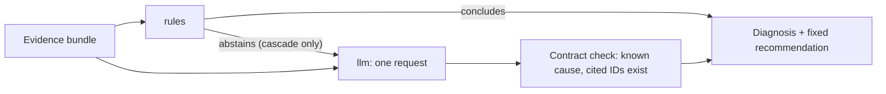

# AKS Readiness Diagnostic Agent v2

Finds out why a Kubernetes container is not Ready from a read-only snapshot (Pod status, probe configuration, probe failure Events, logs), and measures whether an LLM adds anything over explicit rules on the same evidence. Nothing is ever executed; recommendations are fixed, read-only templates.

This is Claude's independent take on the idea in [aks-readiness-diagnostic-agent](https://github.com/JeanneBM/aks-readiness-diagnostic-agent). [docs/design.md](docs/design.md) lists what changed and why. It targets any conformant cluster; AKS is the intended production target, and nothing has been run on AKS yet.

## What it can conclude

| Cause | Concluded only when |
| --- | --- |
| `probe_port_mismatch` | the probe connection is refused and the server logs that it listens on a different port |
| `listener_loopback_only` | the probe connection is refused and the server logs that it listens on the probe port only on 127.0.0.1 or localhost |
| `probe_path_mismatch` | the probe gets 404 and its path lies outside a route prefix the application logs (servlet context path, Actuator base path) |
| `dependency_unavailable` | the probe gets 503 and the application logs an outbound connection failure |
| `healthy` | the container is Ready and no probe failure was recorded after it became Ready |
| `insufficient_evidence` | anything else, including when more than one cause fits |

Abstaining is a correct answer. A Go `net/http` server or stock nginx logs nothing about its port, so a refused probe there is labelled `insufficient_evidence`, not `probe_port_mismatch`.

## Quickstart

Python 3.11+, no runtime dependencies.

```bash
python -m pip install -e .
python -m unittest discover -s tests
readiness-triage diagnose cases/dev/D08-aspnet-port-dotnet8/evidence.json
readiness-triage evaluate --cases cases/dev --output .local/dev-rules
```

On a cluster, with an identity bound to [k8s/collector-role.yaml](k8s/collector-role.yaml):

```bash
readiness-triage collect --allow-cluster-read --context my-aks --namespace shop \
  --pod web-7d9f --container app --output .local/web.json
readiness-triage diagnose .local/web.json
```

To use a model, set `READINESS_ENDPOINT`, `READINESS_API_KEY`, `READINESS_MODEL` (and `READINESS_PROVIDER=openai` for OpenAI) and add `--strategy llm` or `--strategy cascade` together with `--allow-model-calls`. See [docs/usage.md](docs/usage.md).

## Three strategies, one set of evidence



`rules` never calls a model. `llm` makes one request (retried on 429/5xx, at most three attempts). `cascade` asks the model only when the rules abstain.

## How results are reported

Labels are fixed before a run and record two things: the fault that was **injected** and the answer the evidence can **support**. Accuracy is reported over all attempts (provider errors count as misses) and over answered attempts, because the first mixes diagnosis quality with provider availability. Lab recordings are checked against what each scenario was meant to produce; a recording that misses its intended evidence is set aside rather than scored against a wrong label. With a few dozen cases there are no significance tests; the report lists the cases on which strategies disagree.

## What has and has not been shown

| Claim | Evidence | Status |
| --- | --- | --- |
| The rules give the labelled answer on 19 synthetic cases | `tests/test_rules.py` | Passes, but the cases were written alongside the rules: regression coverage, not accuracy |
| Listener patterns match real uvicorn, Flask and gunicorn output | `tests/golden/` | Verified against locally captured output |
| ASP.NET Core and Spring Boot log lines | `cases/dev` | Written from documented formats; ASP.NET Core is checked by lab scenarios R03/R04 once recorded, Spring Boot is not in the lab yet |
| `--limit-bytes` returns the start of the log on a real kubelet | lab scenario R11 | Not yet run |
| The lab scenarios produce the evidence their labels assume | `.github/workflows/lab.yml` | Not yet run |
| `llm` or `cascade` diagnoses better or worse than `rules` | none | No model run yet |

## Next steps

1. Run the lab workflow, review the recording and commit it under `cases/recorded/`.
2. Run `llm` and `cascade` on the recordings, three repetitions each, with a small and a larger model.
3. Add frameworks and faults until the development set has a few dozen recorded cases, including more where rules should abstain.
4. Freeze code, prompt and model settings, then evaluate once on held-out cases prepared by someone who has not seen the rules.
5. Microsoft Entra ID authentication for Azure OpenAI (keys only today).

## Boundaries

The collector reads one Pod, its Events and one container's logs; it never reads Secrets, writes, or execs. Pod, namespace and context names stay out of bundles, since a bundle may go to a model provider. Redaction is pattern-based and incomplete: review bundles before sending them. A model's `summary` and `uncertainty` text are untrusted output. Resistance to prompt injection in logs is not measured beyond one fixture (`D18`).
